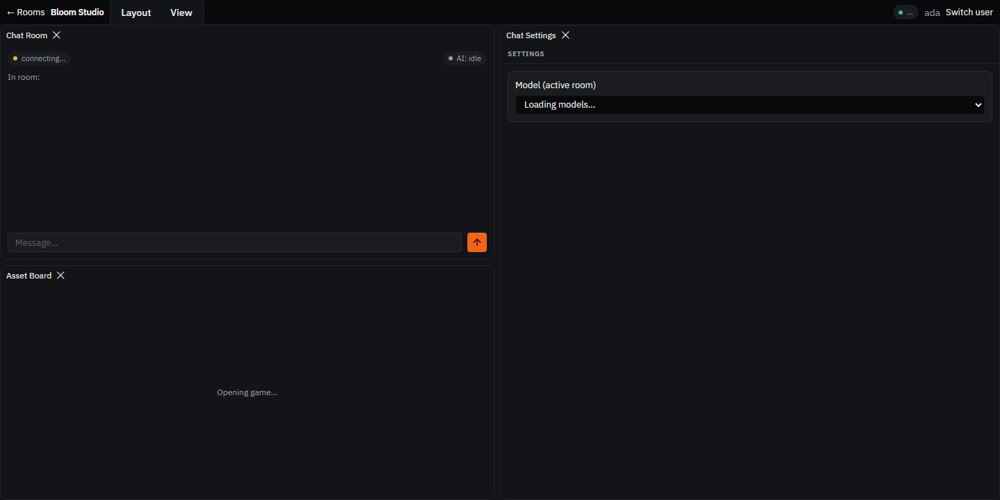

# Bloom

An experimental game-authoring platform that connects an AI-assisted visual studio
to shared deterministic game math and an authoritative runtime.



_The Studio workbench in a test room. This capture shows the authoring shell,
without a loaded game._

## Engineering focus

Bloom separates creative authoring from the code that decides game outcomes:

| Layer               | Responsibility                                                                                                    |
| ------------------- | ----------------------------------------------------------------------------------------------------------------- |
| [Studio](studio/)   | React/TypeScript workbench, chat, game-design documents, asset workflows, and Pixi scene inspection and editing.  |
| [Trusted](trusted/) | Rust deterministic slot math and the game-package format shared across authoring and execution.                   |
| [Runtime](runtime/) | Package verification, seeded outcomes, and audit records in an authoritative server; no AI in outcome generation. |

The prototype also includes simulation and tuning tools, human approval steps,
and a signed demo package. Real-money deployment, certification, and operator
integration are product goals, not claims of a certified or production-ready system.

## Explore locally

The Studio uses Node.js 20.x, npm, Python 3.12+, uv, just, and a local MongoDB
instance. Rust is needed for the math and runtime components.

```text
npm ci
just backend-install
```

In separate terminals, start the recorded-fixture backend and Studio:

```text
just backend-serve-replay
just serve-frontend
```

Open `http://localhost:4200`. Replay mode uses recorded fixtures; it is not a live
provider session. The `just` recipes require their configured shell. For concurrent
checkouts, follow [worktree setup](docs/worktrees.md) so ports, MongoDB data, and
media paths remain isolated. `just engine-serve` starts the Pixi client on port 4300.

For runtime implementation and platform-specific build notes, see the
[runtime server guide](runtime/server/README.md). Demo recipes are in the [justfile](justfile).

## Verification and design

The [CI workflow](.github/workflows/ci.yml) checks Rust, frontend, and Python code.
Install Chromium with `npx playwright install chromium`. Browser Playwright suites
run locally against the replay stack with `just e2e`;
scene tests also require the engine client.

Read the [architecture](docs/superpowers/specs/2026-06-18-bloom-platform-architecture-design.md),
[product intent](docs/north-star.md), and [visual design language](docs/design-language.md)
for the design decisions and longer-term goals.
