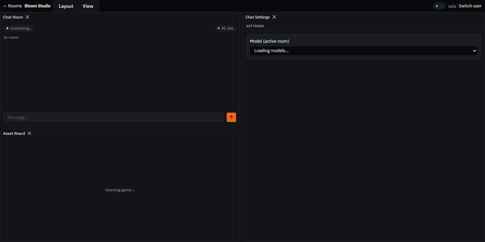

# Studio Design Language

> **Mandate:** This is the authoritative design language; every `studio/frontend`
> surface MUST follow it. The machine source of truth is the `:root` block in
> `studio/frontend/src/styles.css`. The human/agent source of truth is this file.
> Raw colors outside `styles.css` are blocked by a guard test.

## Token System

Exactly **4 surfaces, 2 hairline weights, 3 text tiers, 1 accent**. Nothing in
the app may use a color that is not one of these names.

### Surfaces — 4 elevations, nothing between

| Token            | Value     | Use                                                          |
| ---------------- | --------- | ------------------------------------------------------------ |
| `--canvas`       | `#08090a` | app bg · the gap between floating panels · inset field wells |
| `--surface`      | `#131417` | the floating panel card body · active tab shares this        |
| `--raised`       | `#1b1c1f` | cards / tiles / inputs sitting on a surface                  |
| `--raised-hover` | `#232427` | hover state for raised things & menu items                   |

Elevation only ever moves `canvas → surface → raised → raised-hover`, never
sideways. No component invents a 5th grey.

### Hairlines — translucent white, exactly 2 weights (the Linear signature)

| Token               | Value                    | Use                                                   |
| ------------------- | ------------------------ | ----------------------------------------------------- |
| `--hairline`        | `rgba(255,255,255,0.07)` | every default border: panels, cards, fields, dividers |
| `--hairline-strong` | `rgba(255,255,255,0.12)` | hover/emphasis, resizer, ghost-button edge            |

No hex-grey borders (`#283039`, `#313a47`). Every border is one of these two.

### Text — 3 tiers only

| Token      | Value     | Use                              |
| ---------- | --------- | -------------------------------- |
| `--text-1` | `#ededef` | primary content                  |
| `--text-2` | `#9b9ba4` | secondary text, uppercase labels |
| `--text-3` | `#62626b` | faint / placeholder / disabled   |

**Tailwind utility note:** The Tailwind utilities for these are `text-foreground`
(primary), `text-muted-foreground` (secondary), and `text-faint` (faint) — the
`text-1` / `text-2` / `text-3` utility names do **not** exist.

### Accent — fire orange, rationed

| Token            | Value                   | Use                                |
| ---------------- | ----------------------- | ---------------------------------- |
| `--accent`       | `#f0641e`               | the rationed accent (see rule 3)   |
| `--accent-hover` | `#ff7a33`               | hover/active of accent fills       |
| `--accent-text`  | `#ff8a4d`               | orange text/icons on dark surfaces |
| `--accent-fg`    | `#160a02`               | text on an accent fill             |
| `--selection`    | `rgba(240,100,30,0.14)` | selected-row / active tint         |
| `--success`      | `#3ec28b`               | status                             |
| `--warning`      | `#e7b549`               | status                             |
| `--danger`       | `#f0574d`               | errors (e.g. "generation failed")  |

**Important:** `--color-accent` in the Tailwind `@theme` block is intentionally
set to `--raised-hover` (not `--accent`). This keeps `hover:bg-accent` neutral
for shadcn components. Use `bg-primary` / `text-accent-text` to express orange.

### Legacy shadcn remap

The legacy shadcn names (`--background`, `--muted`, `--border`, `--primary`,
`--foreground`, …) are re-pointed onto the new ramp so utility classes and the
`components/ui/*` layer inherit the language without per-component edits:

- `--background → --surface`, `--muted → --raised`, `--border → --hairline`
- `--primary → --accent`, `--destructive → --danger`
- `--foreground → --text-1`, `--muted-foreground → --text-2`
- `--input → --hairline`, `--ring → --accent`

## The Four Rules

These kill the "AI-generated" look:

1. **4 surfaces, full stop.** No component invents a 5th grey.
2. **Every border is a hairline** — one of the two white-alpha weights. No
   hex-grey borders.
3. **Accent is rationed.** Orange appears only on: active-tab underline · focus
   ring · selected row · and **exactly one primary action per context** (no two
   competing primary-weight buttons in one region). Everything else is a ghost
   button. Orange is never decoration.
4. **3 text tiers only.** Labels are `text-2` uppercase; placeholders `text-3`.

## Component Primitive Catalog

Every surface routes through this small set of styled primitives in
`studio/frontend/src/components/ui/` (props `I`-prefixed per coding standards).
Components stop hand-rolling colors.

### `Button`

| Variant         | Definition                                                       |
| --------------- | ---------------------------------------------------------------- |
| `primary`       | accent fill (`--accent` bg, `--accent-fg` text) — one per region |
| `ghost`         | transparent bg, `--hairline-strong` border, `--text-1` text      |
| `outline`       | transparent bg, `--hairline` border                              |
| `accentOutline` | transparent bg, `--accent` border, `--accent-text` text          |
| `destructive`   | `--danger` fill                                                  |

One `primary` button per region maximum. Everything else is `ghost`.

### `Card`

`--raised` bg, `1px solid var(--hairline)` border, `border-radius: 8px`. Used
for asset tiles and similar raised content on a surface.

### `Input` (Field / Textarea)

`--raised` bg, `1px solid var(--hairline)` border, `border-radius: 6px`,
`--text-3` placeholder, **`--accent` focus ring**. The raised well on the canvas
visually distinguishes the input from its panel.

### `StatusPill`

`--raised`-subtle bg, `--text-2` text, `rounded-full`. Used for connection
status, AI state, mode badge.

### `PanelHeader`

Uppercase `--text-2` label, bottom hairline divider, optional right-slot for
actions. Retokened from earlier ad-hoc styling.

Tabs are produced by the Dockview theme, not a React primitive.

## Dockview Floating-Card Model

The panel model is **"floating cards"** (mockup C). Each Dockview group is a
rounded, hairline-bordered card floating on the canvas with a visible gap between
groups. This supersedes PR #40's seamless model.

- `bloomTheme: DockviewTheme` is derived from `themeAbyssSpaced` (a proven
  spaced/floating-card base), overriding only colors/radius onto our tokens.
- **`gap: 8`** → real 8px spacing between panel cards; `--canvas` shows through
  the gap.
- **`tabGroupIndicator: 'wrap'`** → Chrome-style rounded underline wrapping the
  active tab (the model-C active signal).
- Each group body: `bg = --surface`, `border: 1px solid var(--hairline)`,
  `border-radius: 9px`; tab strip bg = `--surface`.
- Resizer sash: transparent (canvas shows through); hover = `--hairline-strong`.
- Active-tab underline color = `--accent`; active/visible tab bg = `--surface`
  so tab and pane read as one card.

Net: `<DockviewReact theme={bloomTheme} />` — pass via the `theme` prop, not the
old class-only `useApplyTheme`.

## Visual Reference

_The PNG above is produced by the e2e fidelity step. The link may not resolve
until that step lands — that is expected._

Committed mockups (HTML, viewable in browser):

- [Token reference — surfaces, hairlines, text tiers, accent](design-language/mockup-tokens.html)
- [Panel model — direction C (floating cards)](design-language/mockup-panel-model.html)
- [Direction comparison — A/B/C](design-language/mockup-directions.html)

## Fidelity Gate

Three layers, cheap → strong (consistent with the CI cost policy: browser e2e
stays local; only the cheap check gates CI).

1. **No-raw-color guard (CI-affordable).** `studio/frontend/src/design-language.guard.spec.ts`
   scans `studio/frontend/src` for any hex literal or non-token `rgba()` outside
   `styles.css` and must return zero hits. This is a mechanical guarantee that
   components cannot drift back to ad-hoc colors and gates every PR.

2. **Computed-style invariants in Playwright (local, source of truth).**
   `studio/frontend/e2e/theme.spec.ts` asserts invariants against the real running
   shell (not pixel snapshots — those are brittle across fonts/AA):
   - Docked groups are floating hairline cards: `border-radius: 9px`, `1px` border,
     `border-color: rgba(255,255,255,0.07)`.
   - The `--canvas` token resolves to `#08090a`.
   - A reference screenshot of the workbench is captured (committed fidelity
     artifact).

   The **accent-rationing rule (rule 3)** is enforced by the `Button` variant
   system + the no-raw-color guard (layer 1) + code review + the committed
   reference screenshot — not by an e2e assertion today. Future hardening:
   per-element invariants (active-tab underline = accent, Field focus ring =
   accent, one accent-filled button per region) could be added to
   `theme.spec.ts`.

3. **Reference screenshot (human eyeball).** A Playwright step captures the real
   workbench (top bar + Chat Room + Asset Board, replay backend) to the PNG at
   `docs/design-language/reference-workbench.png`, committed alongside the
   approved mockups. Any future visual change re-shoots it; the diff is reviewable
   in the PR.

Run via `just e2e` (replay backend) before every PR. CI runs only layer 1.

## Changing the Design Language

- **Changing a token VALUE** requires updating
  `studio/frontend/src/styles.tokens.spec.ts` to match.
- **Adding a surface / border weight / text tier** is a DESIGN change — get
  sign-off, don't just add a token. The whole point of the constraint is that the
  count stays fixed.
